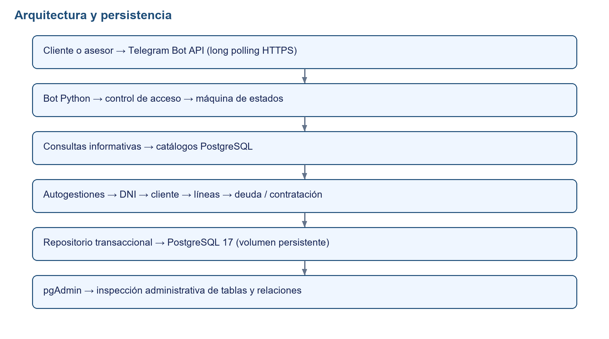
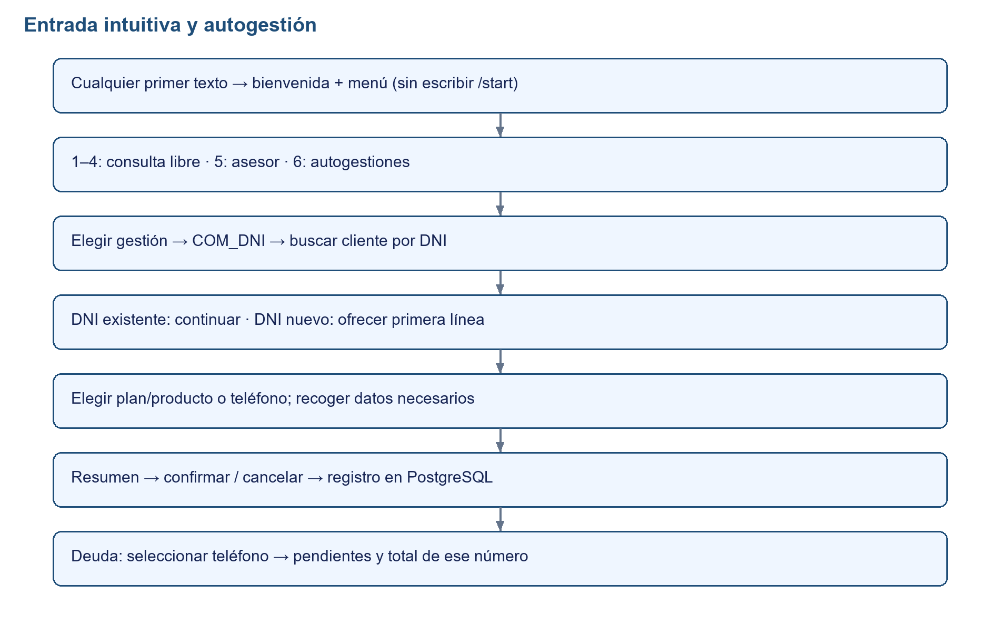
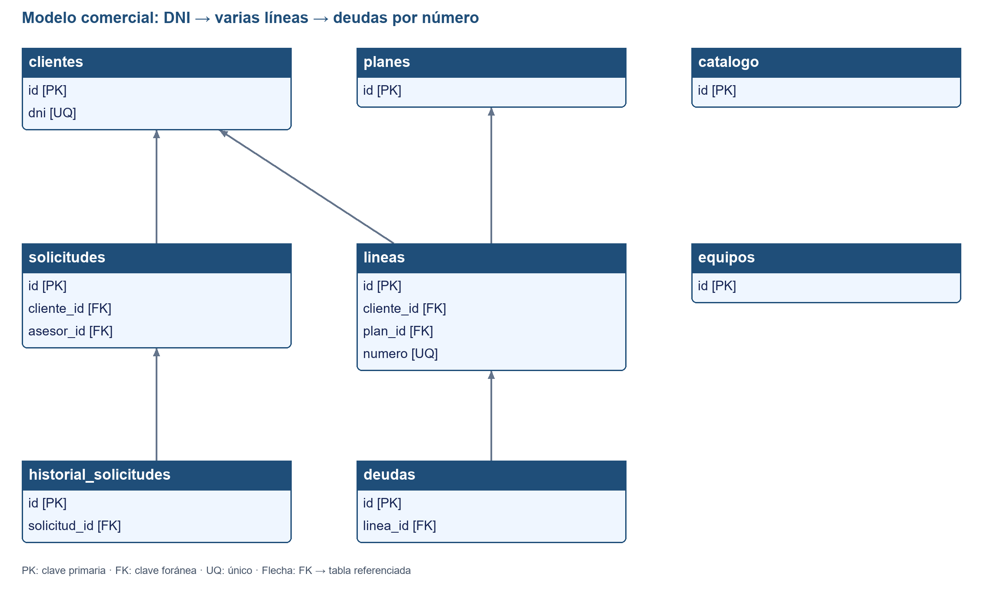
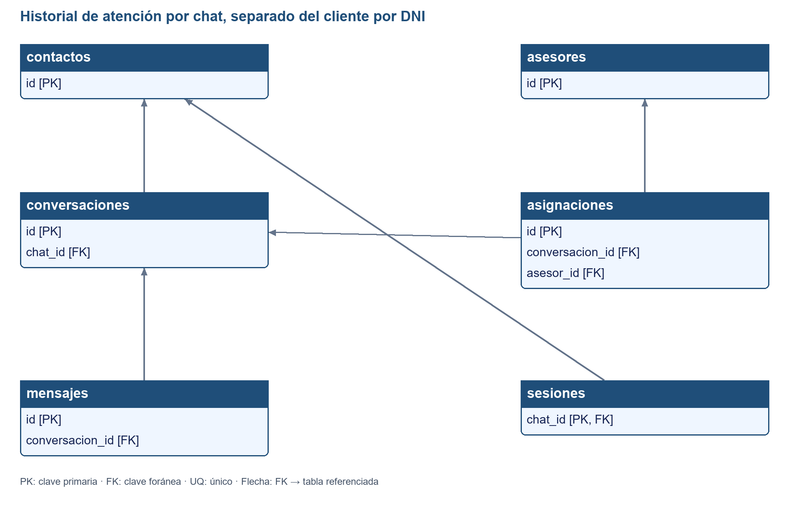
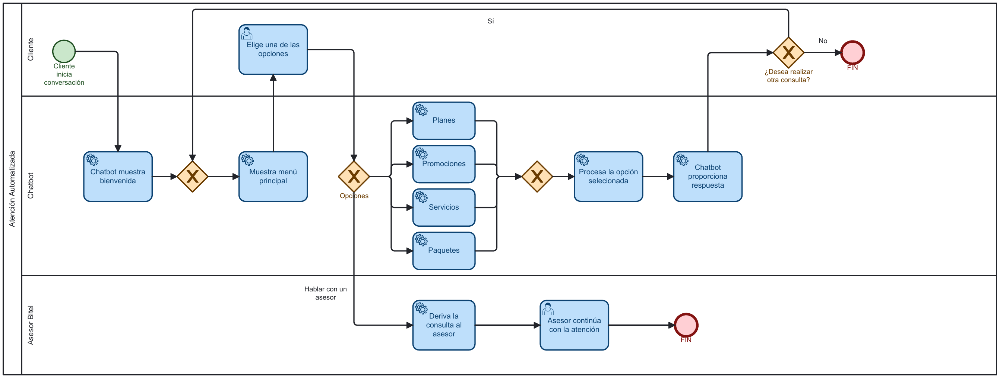

# DOCUMENTACIÓN TÉCNICA

Chatbot de atención y autogestiones telefónicas — TeleBOT Integrador

| Dato | Detalle |
| --- | --- |
| Autores | Vidal Maza. J, Zevallos Miranda. C, Sarmiento Castro. L. |
| Versión | 3.0 — autogestiones por DNI |
| Fecha de generación | 08/10/2026 |
| Estado | Implementado sobre PostgreSQL; Telegram simulado en pruebas automatizadas. |
| Alcance | Consulta pública, identificación por DNI, múltiples líneas, deuda por teléfono y solicitudes de servicio. |

Se conservan el documento original y la versión 2.0. Esta versión reemplaza la descripción de clientes por Telegram y las altas demo automáticas por el modelo comercial por DNI.

# Índice

1. Descripción general del proyecto

2. Alcance actual

3. Arquitectura y componentes

4. Tecnologías y dependencias

5. Configuración y estructura

6. Conversación y estados

7. Catálogos desde PostgreSQL

8. Gestión de asesores

9. Requerimientos funcionales

10. Requerimientos no funcionales

11. Instalación y operación

12. Pruebas y resultados

13. Manejo de errores e identificación

14. Limitaciones actuales

15. Base de datos y diccionario

16. Diagrama de la base de datos

# 1. Descripción general del proyecto

Bot de Telegram para consultar información telefónica y ejecutar autogestiones sobre registros PostgreSQL. Cualquier primer mensaje de texto muestra bienvenida y menú. Las consultas de catálogo no requieren DNI; cada nueva gestión comercial solicita un DNI y busca al titular. No existe una vinculación permanente entre DNI y cuenta Telegram.

Un cliente tiene un DNI único y puede tener varias líneas, cada una con número único y plan. Confirmar una nueva línea guarda el registro en la base; un alta de cliente se confirma junto a su primera línea. La deuda se consulta por teléfono, nunca como un importe inventado.

# 2. Alcance actual

| Función | Resultado implementado |
| --- | --- |
| Consulta | Planes, promociones, servicios y paquetes desde PostgreSQL, sin identificación. |
| Línea nueva | Cliente existente: línea adicional. Cliente nuevo: titular y primera línea en una transacción. |
| Deuda | DNI → seleccionar teléfono propio → registros no pagados y total. |
| Portabilidad | Plan, número de origen y operador; solicitud pendiente para asesor. |
| Baja | Número asociado, motivo y detalle si es Otro; solicitud pendiente. |
| Equipo | Equipo, contado/evaluación de cuotas y dirección de entrega; solicitud pendiente. |
| Servicio | Servicio, dirección de instalación o línea asociada; solicitud pendiente. |
| Mis solicitudes | Últimas 20 del cliente indicado por DNI, desde cualquier chat. |
| Asesor | Toma exclusiva, respuesta, cierre y seguimiento de solicitudes. |

# 3. Arquitectura y componentes

Figura 1. Arquitectura del sistema actual.

| Componente | Responsabilidad |
| --- | --- |
| bot_corregido.py | Acceso público/privado, menú, handlers, asesor y catálogo informativo. |
| commerce.py | DNI, captura de datos, teléfono seleccionado, resumen y confirmación. |
| database.py | Modelo y repositorio: transacciones, bloqueo por DNI, unicidad e idempotencia. |
| persistence.py | Registra entradas, respuestas y sesiones fuera del bucle asíncrono. |
| PostgreSQL / pgAdmin | Datos persistentes y administración web. |
| Alembic | Migraciones 001 histórica y 002 de identidad por DNI. |

# 4. Tecnologías y dependencias

| Tecnología | Versión / definición |
| --- | --- |
| Python | 3.14 |
| PostgreSQL | 17 |
| pgAdmin | 9 |
| Docker Compose | Servicios bot, postgres y pgadmin |
| python-telegram-bot | 22.8 |
| python-dotenv | 1.2.4 |
| SQLAlchemy | 2.0.48 |
| psycopg[binary] | 3.3.3 |
| alembic | 1.18.4 |

python-docx y Pillow se instalan separadamente desde requirements-docs.txt para regenerar el Word y los PNG.

# 5. Configuración y estructura

| Variable .env | Uso |
| --- | --- |
| TELEGRAM_BOT_TOKEN | Token de BotFather; no se publica en documentos. |
| ACCESO_PUBLICO | True: cualquier chat privado. False: solo IDs autorizados y asesores. |
| ADMIN_CHAT_IDS | IDs positivos de asesores, separados por comas. |
| ALLOWED_USER_IDS | Lista de acceso para modo privado. |
| POSTGRES_PASSWORD / DB_APP_PASSWORD / PGADMIN_PASSWORD | Contraseñas independientes de administrador, aplicación y web. |

Compose solo entrega las variables necesarias a cada contenedor. .env y respaldos quedan fuera de la imagen y de Git. Tras cambiar IDs o acceso: docker compose up -d --force-recreate bot.

Archivos adicionales: cargar_ejemplos.py, test_flujo.py, test_postgres.py, benchmark.py, resultados_verificacion.json, generar_documentacion.py, docs_generados/ y respaldos/.

# 6. Conversación y estados

Figura 2. Entrada, identificación y confirmación.

| Estado | Función |
| --- | --- |
| MENU | 1–4 catálogos, 5 asesor, 6 autogestiones. |
| PLANES / PROMOCIONES / SERVICIOS / PAQUETES | Opciones obtenidas de PostgreSQL; 0 vuelve al menú. |
| OTRA_CONSULTA | 1 nueva consulta, 2 finalizar, 3 regresar. |
| ASESOR | Enrutamiento a asesor asignado o aviso a los disponibles. |
| GESTIONES | 1 línea, 2 portabilidad, 3 baja, 4 equipo, 5 deuda, 6 solicitudes, 7 servicio. |
| COM_DNI / COM_ALTA | Validación de DNI; si no existe, ofrecer primera línea sin crear cliente aún. |
| COM_PRODUCTO / COM_LINEA | Elegir producto o un número asociado al DNI. |
| COM_NOMBRE / COM_CONTACTO | Nombre completo y teléfono de contacto del cliente nuevo. |
| COM_NUMERO / COM_OPERADOR | Número a portar y operador de origen. |
| COM_MOTIVO / COM_DETALLE | Motivo de baja y descripción para Otro. |
| COM_MODALIDAD / COM_DIRECCION | Forma de adquisición y ubicación de entrega/instalación. |
| COM_CONFIRMAR | Resumen de datos: 1 confirmar, 2 cancelar, 0 menú. |

menú, menu o inicio reinicia desde texto; /start sigue como comando opcional. Reiniciar cancela el formulario y la atención de chat, pero no solicitudes confirmadas. El DNI se solicita de nuevo al comenzar cada gestión. No se requiere DNI para hablar con un asesor.

# 7. Catálogos desde PostgreSQL

No existe un catálogo comercial de respaldo en Python. PLANES consulta planes; los demás menús filtran catalogo por categoría. Equipos se obtiene de equipos. Un catálogo vacío se informa como tal. La carga inicial de ejemplos es explícita; no se restaura al reiniciar.

En una adquisición se conserva el precio mostrado y se comprueba nuevamente al confirmar. Si cambió o el producto no existe, se pide volver al menú y seleccionar de nuevo.

# 8. Gestión de asesores

| Comando | Uso |
| --- | --- |
| /id | ID Telegram del participante autorizado por el modo de acceso. |
| /tomar ID_CHAT | Tomar un chat pendiente; primer asesor disponible. |
| /reply ID_CHAT mensaje | Responder únicamente al chat propio. |
| /finalizar ID_CHAT | Cerrar únicamente el chat propio. |
| /solicitudes | Últimas 20 solicitudes globales. |
| /estado ID en_atencion/completada/cancelada | Transiciones válidas y exclusividad del asesor responsable. |

pendiente → en_atencion → completada/cancelada, o pendiente → cancelada. La línea nueva se registra directamente como completada. Las otras gestiones se registran pendientes. El chat de origen recibe avisos; cliente_id nunca se usa como destino Telegram.

# 9. Requerimientos funcionales

| Código | Requerimiento actualizado |
| --- | --- |
| RF01 | Iniciar con cualquier primer texto; /start es opcional. |
| RF02 | Bienvenida y menú principal con seis opciones. |
| RF03 | Opciones numéricas con cancelación intuitiva por texto. |
| RF04–RF07 | Consultar planes, promociones, servicios y paquetes desde PostgreSQL. |
| RF08 | Entradas inválidas no avanzan el formulario. |
| RF09–RF11 | Nueva consulta, regreso y cierre de la consulta automática. |
| RF12–RF16 | Derivación, avisos, toma exclusiva, respuesta y cierre por asesor. |
| RF17 | Obtener ID Telegram según control de acceso. |
| RF18 | Adquirir línea con DNI, plan y número único. |
| RF19 | Solicitar portabilidad con número y operador. |
| RF20 | Solicitar baja de un número asociado con motivo. |
| RF21 | Solicitar equipo con modalidad y dirección. |
| RF22 | Elegir teléfono y consultar exclusivamente su deuda pendiente. |
| RF23–RF24 | Consultar solicitudes y cambiar estados con historial. |
| RF25 | Persistir interacciones sin crear clientes comerciales por escribir al bot. |
| RF26 | Acceso público o privado configurable; asesor siempre restringido. |
| RF27 | Identificar por DNI sin vincularlo permanentemente a Telegram. |
| RF28 | Ofrecer alta ante DNI desconocido; cliente y primera línea atómicos. |
| RF29 | Un DNI admite varios números únicos con sus respectivos planes. |
| RF30 | Servicio pide dirección o línea según datos del catálogo. |
| RF31 | Cancelación no registra cliente/solicitud; reintento de la misma confirmación no duplica. |

# 10. Requerimientos no funcionales

| Código | Atributo y evidencia |
| --- | --- |
| RNF01 | Usabilidad: inicio por texto, preguntas pertinentes y resumen legible. |
| RNF02 | Compatibilidad: Python y contenedores Linux. |
| RNF03 | Rendimiento: p95 local < 1000 ms; ver medición y alcance en sección 12. |
| RNF04 | Confiabilidad: separación por chat, transacciones de alta y deuda por línea. |
| RNF05–RNF06 | Secretos fuera del código; permisos de asesor independientes del acceso público. |
| RNF07–RNF09 | Separación de módulos, validaciones y dependencias fijadas. |
| RNF10 | Múltiples participantes y asesores en una instancia; sin replicación. |
| RNF11–RNF12 | Persistencia PostgreSQL e historial de estados. |
| RNF13 | Unicidad de DNI/número y confirmación idempotente bajo concurrencia. |

# 11. Instalación y operación

docker compose up -d --build

docker compose ps

docker compose logs --tail 50 bot

docker compose stop bot

docker compose start bot

pgAdmin: http://localhost:5050, admin@telebot.com. PostgreSQL: telebot; aplicación: telebot_app. Contraseñas desde .env. No usar down -v para detener: elimina volúmenes.

## 11.1 Migración y carga autorizada

La revisión 002 retira las tablas comerciales demo anteriores y conserva el historial de atención, renombrando clientes anterior a contactos. Es una migración específica del avance autorizado, no una limpieza en cada arranque. Respaldo: respaldos/telebot_antes_dni.dump.

En instalación nueva: python -m alembic upgrade head y luego cargar_ejemplos.py dentro del contenedor. El script carga 15 clientes y 30 líneas en una transacción y no duplica la carga existente. No repara filas de ejemplo eliminadas ni sustituye otros catálogos.

DNI de prueba: 00001001–00001015. Cinco clientes con una línea, cinco con dos y cinco con tres. Hay números sin deuda, con deuda pagada y con dos pendientes. 00001011 permite probar tres números y dos deudas pendientes en el tercero. Las adquisiciones no generan deuda.

# 12. Pruebas y resultados

Las pruebas usan PostgreSQL real y Telegram simulado en telebot_test. La medición recrea los ejemplos solo en esa base. Ninguna prueba envía mensajes a cuentas reales.

| Resultado | Valor |
| --- | --- |
| flujo | 15 |
| postgresql | 7 |
| total | 22 |
| duracion_s | 4.381 |
| resultado | OK |

| Métrica local | Resultado |
| --- | --- |
| python | 3.14.8 |
| base | telebot_test |
| chats_simulados | 50 |
| actualizaciones_secuenciales | 300 |
| contactos_guardados | 50 |
| mensajes_guardados | 600 |
| clientes_guardados | 15 |
| duracion_s | 8.03 |
| media_ms | 25.65 |
| p95_ms | 29.416 |
| max_ms | 34.094 |
| objetivo_p95_ms | 1000 |
| cumple_objetivo_local | True |
| alcance | Telegram simulado; PostgreSQL real; carga secuencial, una instancia; no prueba de concurrencia ni SLA real. |

Cobertura: consulta pública sin alta, 15 clientes/30 líneas, deuda por número, DNI inválido, cancelación, alta atómica, líneas adicionales desde otro chat, colisión de números, confirmación concurrente, rollback, cambio de precio, portabilidad/equipo/servicio/baja y seguimiento por asesor. El benchmark secuencial no mide la red Telegram.

Comando: docker compose run --rm --no-deps -e DB_NAME=telebot_test bot python -m unittest -v test_flujo test_postgres

Medición: docker compose run --rm --no-deps -e DB_NAME=telebot_test bot python benchmark.py

# 13. Manejo de errores e identificación

DNI: ocho dígitos ASCII; teléfono: nueve comenzando por 9. Nombre completo, operador y dirección tienen validaciones de longitud. Si falla PostgreSQL se avisa sin continuar el flujo. Si falla la asignación de número, se revierte también el alta del cliente.

Cada confirmación tiene un UUID único. Un bloqueo transaccional por DNI serializa confirmaciones simultáneas; UNIQUE(numero) más reintentos limita las colisiones. Se verifica el producto/precio y la pertenencia de la línea en la base, no solo en el texto recibido.

Por decisión del diseño, un DNI registrado se puede usar desde cualquier chat. Su existencia es identificación del registro, no autenticación del titular. No hay OTP ni validación externa del DNI. El teléfono solicitado es un dato de contacto, no una verificación de identidad.

# 14. Limitaciones actuales

Los 15 clientes y el catálogo inicial son ejemplos. El bot trabaja con registros de la base; no genera importes al consultar.

Asignar un número en esta base no activa una línea en una operadora. No hay integración Bitel ni cobros.

Portabilidad, bajas, equipos y servicios son solicitudes. Cambiar su estado no ejecuta la operación externa.

No hay turnos ni panel operativo de asesores; pgAdmin es administración técnica.

Sesiones se reinician al arrancar. Updates pendientes de Telegram se descartan deliberadamente.

No hay tabla audit_log adicional ni transacción distribuida entre Telegram y PostgreSQL.

producto_id y linea_id dentro del JSON no son FKs; contract verifica producto y pertenencia de línea.

Capturas de Telegram y atención con dos cuentas reales están pendientes de evidencia manual.

# 15. Base de datos y diccionario

14 tablas de aplicación más alembic_version. Este diccionario se deriva directamente del modelo SQLAlchemy, incluyendo tipos, nulabilidad, PK, FK y unicidad; no inventa columnas ni relaciones. Los valores default de SQLAlchemy pueden aplicarse desde Python y no ser defaults del servidor; se distinguen abajo.

## 15.1 clientes

Titulares comerciales identificados por DNI único, independientes de Telegram. El alta por el bot crea el titular y su primera línea en una sola transacción.

| Campo | Tipo PostgreSQL | Restricciones / default | Descripción |
| --- | --- | --- | --- |
| id | BIGINT | NOT NULL; PK | Identificador interno del registro. |
| dni | VARCHAR(8) | NOT NULL; UNIQUE | Documento de ocho dígitos; conservar ceros iniciales. UNIQUE y CHECK de formato. |
| nombre | VARCHAR(200) | NOT NULL | Nombre completo del cliente, nombre de producto o nombre mostrado por Telegram. |
| telefono | VARCHAR(9) | NOT NULL | Teléfono de contacto de nueve dígitos comenzando por 9; no es la línea asignada. |
| creado | TIMESTAMP WITH TIME ZONE | NULL; Default BD: now() | Fecha de alta con zona horaria. |

## 15.2 contactos

Participantes de Telegram. Su id es el chat_id. Escribir al bot crea un contacto, no un cliente comercial. No guarda un DNI permanente.

| Campo | Tipo PostgreSQL | Restricciones / default | Descripción |
| --- | --- | --- | --- |
| id | BIGINT | NOT NULL; PK | ID Telegram, no DNI ni identificador comercial. |
| nombre | VARCHAR(200) | NULL | Nombre completo del cliente, nombre de producto o nombre mostrado por Telegram. |
| creado | TIMESTAMP WITH TIME ZONE | NULL; Default BD: now() | Fecha de alta con zona horaria. |

## 15.3 asesores

IDs Telegram autorizados para atención humana; la lista operativa proviene de ADMIN_CHAT_IDS.

| Campo | Tipo PostgreSQL | Restricciones / default | Descripción |
| --- | --- | --- | --- |
| id | BIGINT | NOT NULL; PK | ID Telegram, no DNI ni identificador comercial. |

## 15.4 conversaciones

Historial de conversaciones por chat, abiertas, cerradas o reiniciadas. No depende de que el visitante haya proporcionado un DNI.

| Campo | Tipo PostgreSQL | Restricciones / default | Descripción |
| --- | --- | --- | --- |
| id | INTEGER | NOT NULL; PK | Identificador interno del registro. |
| chat_id | BIGINT | NOT NULL; FK → contactos.id | Canal Telegram de interacción o de origen; no vincula permanentemente el DNI a la cuenta. |
| estado | VARCHAR(30) | NOT NULL; Default Python: abierta | abierta, cerrada o reiniciada. |
| inicio | TIMESTAMP WITH TIME ZONE | NULL; Default BD: now() | Inicio de la conversación/asignación. |
| fin | TIMESTAMP WITH TIME ZONE | NULL | Cierre; nulo mientras no haya finalizado. |

## 15.5 mensajes

Textos de entrada/salida, avisos de asesores y marcas de tiempo por conversación.

| Campo | Tipo PostgreSQL | Restricciones / default | Descripción |
| --- | --- | --- | --- |
| id | INTEGER | NOT NULL; PK | Identificador interno del registro. |
| conversacion_id | INTEGER | NOT NULL; FK → conversaciones.id | Conversación a la que pertenece el mensaje o la asignación. |
| autor_id | BIGINT | NULL | ID del autor del mensaje; puede ser nulo en respuestas del bot. |
| rol | VARCHAR(20) | NOT NULL | Origen del texto: cliente (participante), bot o asesor. |
| texto | TEXT | NOT NULL | Identificador interno del registro. |
| fecha | TIMESTAMP WITH TIME ZONE | NULL; Default BD: now() | Fecha de registro con zona horaria. |

## 15.6 sesiones

Espejo del estado temporal de un chat en JSON. No es una cuenta de cliente; se vacía al reiniciar y no se restaura la identificación anterior.

| Campo | Tipo PostgreSQL | Restricciones / default | Descripción |
| --- | --- | --- | --- |
| chat_id | BIGINT | NOT NULL; PK; FK → contactos.id | Canal Telegram de interacción o de origen; no vincula permanentemente el DNI a la cuenta. |
| datos | JSON | NOT NULL | JSON con estado del chat o detalle del formulario, según la tabla. |

## 15.7 asignaciones

Historial de asesores que tomaron un chat. fin nulo indica una asignación sin cerrar. La exclusividad de una toma se controla en la instancia del bot.

| Campo | Tipo PostgreSQL | Restricciones / default | Descripción |
| --- | --- | --- | --- |
| id | INTEGER | NOT NULL; PK | Identificador interno del registro. |
| conversacion_id | INTEGER | NOT NULL; FK → conversaciones.id | Conversación a la que pertenece el mensaje o la asignación. |
| asesor_id | BIGINT | NOT NULL; FK → asesores.id | Asesor responsable de una asignación o solicitud. |
| inicio | TIMESTAMP WITH TIME ZONE | NULL; Default BD: now() | Inicio de la conversación/asignación. |
| fin | TIMESTAMP WITH TIME ZONE | NULL | Cierre; nulo mientras no haya finalizado. |

## 15.8 planes

Catálogo único de planes: se utiliza tanto para consulta informativa como para adquirir líneas.

| Campo | Tipo PostgreSQL | Restricciones / default | Descripción |
| --- | --- | --- | --- |
| id | INTEGER | NOT NULL; PK | Identificador interno del registro. |
| nombre | VARCHAR(100) | NOT NULL | Nombre completo del cliente, nombre de producto o nombre mostrado por Telegram. |
| precio | NUMERIC(12, 2) | NOT NULL | Importe decimal en soles. Se vuelve a comprobar al confirmar una adquisición. |
| descripcion | TEXT | NOT NULL; Default BD:  | Contenido informativo consultado directamente en PostgreSQL. |

## 15.9 equipos

Catálogo de equipos y precios; su adquisición registra una solicitud para atención.

| Campo | Tipo PostgreSQL | Restricciones / default | Descripción |
| --- | --- | --- | --- |
| id | INTEGER | NOT NULL; PK | Identificador interno del registro. |
| nombre | VARCHAR(100) | NOT NULL | Nombre completo del cliente, nombre de producto o nombre mostrado por Telegram. |
| precio | NUMERIC(12, 2) | NOT NULL | Importe decimal en soles. Se vuelve a comprobar al confirmar una adquisición. |

## 15.10 catalogo

Promociones, servicios y paquetes. requiere_direccion decide si un servicio pide dirección de instalación; en caso contrario pide una línea asociada.

| Campo | Tipo PostgreSQL | Restricciones / default | Descripción |
| --- | --- | --- | --- |
| id | INTEGER | NOT NULL; PK | Identificador interno del registro. |
| categoria | VARCHAR(30) | NOT NULL | PROMOCIONES, SERVICIOS o PAQUETES. |
| nombre | VARCHAR(100) | NOT NULL | Nombre completo del cliente, nombre de producto o nombre mostrado por Telegram. |
| descripcion | TEXT | NOT NULL | Contenido informativo consultado directamente en PostgreSQL. |
| precio | NUMERIC(12, 2) | NULL | Importe decimal en soles. Se vuelve a comprobar al confirmar una adquisición. |
| requiere_direccion | BOOLEAN | NOT NULL; Default BD: false | Solicita dirección de instalación para este servicio. |

## 15.11 lineas

Números contratados por un cliente. Un DNI puede tener varios números; cada línea tiene un plan. numero es único. activa se conserva en el esquema pero no filtra las autogestiones.

| Campo | Tipo PostgreSQL | Restricciones / default | Descripción |
| --- | --- | --- | --- |
| id | INTEGER | NOT NULL; PK | Identificador interno del registro. |
| cliente_id | BIGINT | NOT NULL; FK → clientes.id | ID interno del titular comercial, independiente del ID Telegram. |
| numero | VARCHAR(30) | NOT NULL; UNIQUE | Número de nueve dígitos comenzando por 9, asignado sin repetir otro número de lineas. |
| plan_id | INTEGER | NOT NULL; FK → planes.id | Plan contratado para esta línea. |
| activa | BOOLEAN | NOT NULL; Default Python: True | Campo histórico; se conserva sin considerar su estado en estos flujos. |

## 15.12 deudas

Importes por línea, no por chat ni globalmente por cliente. Solo pagada=false se muestra como pendiente. El bot no genera deudas al contratar.

| Campo | Tipo PostgreSQL | Restricciones / default | Descripción |
| --- | --- | --- | --- |
| id | INTEGER | NOT NULL; PK | Identificador interno del registro. |
| linea_id | INTEGER | NOT NULL; FK → lineas.id | Línea a la que pertenece la deuda. |
| importe | NUMERIC(12, 2) | NOT NULL | Monto de la deuda en soles; precisión NUMERIC(12,2). |
| vencimiento | VARCHAR(10) | NULL | Fecha de vencimiento guardada como texto YYYY-MM-DD; no es una columna DATE. |
| pagada | BOOLEAN | NOT NULL; Default Python: False | Indica si la deuda está pagada; los registros pagados no suman al total pendiente. |

## 15.13 solicitudes

Gestiones comerciales con cliente titular, datos, estado, chat de origen y UUID de operación para impedir repetir la misma confirmación.

| Campo | Tipo PostgreSQL | Restricciones / default | Descripción |
| --- | --- | --- | --- |
| id | INTEGER | NOT NULL; PK | Identificador interno del registro. |
| cliente_id | BIGINT | NOT NULL; FK → clientes.id | ID interno del titular comercial, independiente del ID Telegram. |
| tipo | VARCHAR(30) | NOT NULL | linea_nueva, portabilidad, baja, equipo o servicio. Consultar deuda no crea solicitud. |
| datos | JSON | NOT NULL | JSON con estado del chat o detalle del formulario, según la tabla. |
| chat_id | BIGINT | NULL | Canal Telegram de interacción o de origen; no vincula permanentemente el DNI a la cuenta. |
| operacion | VARCHAR(36) | NULL; UNIQUE | UUID de una confirmación. UNIQUE garantiza que el reintento no repita el registro. |
| estado | VARCHAR(30) | NOT NULL; Default Python: pendiente | pendiente, en_atencion, completada o cancelada. |
| asesor_id | BIGINT | NULL; FK → asesores.id | Asesor responsable de una asignación o solicitud. |
| fecha | TIMESTAMP WITH TIME ZONE | NULL; Default BD: now() | Fecha de registro con zona horaria. |

## 15.14 historial_solicitudes

Cambios de estado de una solicitud y responsable. Se registra junto a la solicitud en la misma transacción.

| Campo | Tipo PostgreSQL | Restricciones / default | Descripción |
| --- | --- | --- | --- |
| id | INTEGER | NOT NULL; PK | Identificador interno del registro. |
| solicitud_id | INTEGER | NOT NULL; FK → solicitudes.id | Solicitud cuyo cambio de estado se registra. |
| estado | VARCHAR(30) | NOT NULL | pendiente, en_atencion, completada o cancelada. |
| responsable_id | BIGINT | NULL | ID del participante que realizó el cambio; no es una FK por abarcar cliente/asesor. |
| fecha | TIMESTAMP WITH TIME ZONE | NULL; Default BD: now() | Fecha de registro con zona horaria. |

## 15.15 alembic_version

Tabla técnica administrada por Alembic: version_num VARCHAR(32), PK NOT NULL. Guarda la revisión aplicada (002). No representa datos de clientes.

# 16. Diagrama de la base de datos

Figura 3. Dominio comercial. solicitudes.asesor_id referencia asesores en la figura 4.

Figura 4. Atención por chat separada de la identidad por DNI.

| FK | Tabla referenciada |
| --- | --- |
| conversaciones.chat_id | contactos.id |
| lineas.cliente_id | clientes.id |
| lineas.plan_id | planes.id |
| sesiones.chat_id | contactos.id |
| solicitudes.asesor_id | asesores.id |
| solicitudes.cliente_id | clientes.id |
| asignaciones.asesor_id | asesores.id |
| asignaciones.conversacion_id | conversaciones.id |
| deudas.linea_id | lineas.id |
| historial_solicitudes.solicitud_id | solicitudes.id |
| mensajes.conversacion_id | conversaciones.id |

Relación principal: clientes 1:N lineas; planes 1:N lineas; lineas 1:N deudas. Cada contacto tiene 0..1 sesión y N conversaciones. solicitudes tiene chat_id como dato de origen sin FK; no existe FK permanente entre contactos y clientes. El Mermaid completo incluye todos los campos y relaciones en docs_generados/modelo_datos.mmd.

# Anexo A. Flujo histórico original

Figura A1. Referencia histórica v1; no describe el alta por DNI actual.

# Anexo B. Trazabilidad

| Grupo | Verificación |
| --- | --- |
| Entrada, catálogo, permisos y asesor | test_flujo.py + integración PostgreSQL. |
| DNI, varias líneas, deuda y adquisiciones | test_postgres.py: consultas, transacciones y concurrencia. |
| Persistencia y rendimiento | benchmark.py y resultados_verificacion.json. |
| Esquema y relaciones | Metadatos SQLAlchemy y migraciones 001 → 002. |
